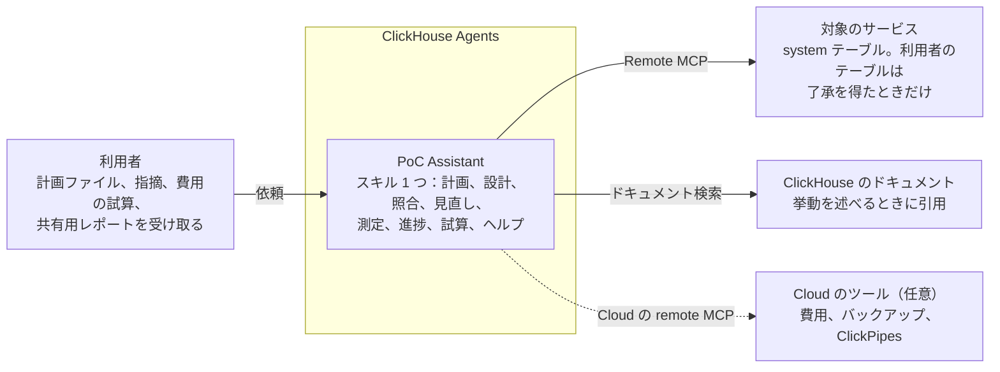

# PoC Assistant

**powered by [ClickHouse Agents](https://clickhouse.com/docs/products/cloud/features/ai-ml/agents)**

ClickHouse Cloud の PoC（概念実証）を、推測でなく根拠で進めるためのエージェントです。 
サービスの system テーブルと公式ドキュメントを読み、数値とその根拠を添えて答えます。

[始め方](#始め方) | [通しの手順](docs/walkthrough.ja.md) | [導入の手順](docs/setup.ja.md) | [ドキュメントのサイト](https://tkykenmt-at-ch.github.io/clickhouse-poc-assistant/index.ja.html) | [English](README.md)

> [!NOTE]
> オープンソース（Apache-2.0）のプロジェクトで、ClickHouse がサポートする製品ではありません。

## 使いどころ

スキルは 1 つで、PoC の段階ごとに段があります。自分の言葉で頼めば、使う段はエージェントが選びます。エージェント自身の設定も案内します。「何ができますか」「MCP サーバーの足し方を教えて」と聞いてください。

| 1 計画 | 2 設計 | 3 照合 | 4 見直し | 5 測定 | 6 進捗 | 7 試算 |
|:---:|:---:|:---:|:---:|:---:|:---:|:---:|
| 成功基準と、それぞれの測り方 | 構築の前に決める基盤、表、流し込み | 設計と今のサービスの照合と、次の一手 | テーブルとクエリの設計の点検 | サイジング統計と負荷試験の比較 | 日次のメモと週次のまとめ | 本番の費用と共有用のレポート |

設計と照合のあいだの構築（表の作成、流し込みの設定、流し込み）は利用者が行います。エージェントの接続は読み取り専用で、候補を書き、構築したものを読んで確かめます。

<b>段階ごとの段</b>

| 段階 | 段 | 役割 |
|---|---|---|
| 計画 | `plan-builder` | ワークロードと環境を聞き、成功基準の案を測り方と公開資料の出典つきで出し、PoC 計画を Markdown で書き出す。合格ラインは利用者が決める |
| 設計 | `architecture-design` | 基盤の層の判断（提供の形、プロバイダとリージョン、接続経路、連携、セキュリティ、計算資源の分け方、バックアップ）を、条件による分かれ方と公式のページつきで示す。移行元のスキーマ、サンプル行、代表的なクエリから、CREATE TABLE の候補、付属物、流し込みの経路を、選んだ理由の規則つきで書く。手がかりが足りなければ、作り上げずに聞く |
| 照合 | `fit-gap` | 構築の途中や後に、サービスを設計と照らし合わせる。表とキー、列の型、ビューと辞書、基盤の設定、流し込みの形、移行元との件数、流し込みの失敗、鮮度を見て、合っている・違う・まだないと次の一手を出す |
| 見直し | `schema-query-advisor` | テーブル設計、クエリの型、投入の形を見て、改善の候補を最大 5 件、根拠のルールかドキュメントと確かめ方つきで出す |
| 測定 | `sizing-stats` | サイジング用の統計（保存量、圧縮率、投入の量とピーク、クエリの量、1 回あたりの重さ）を集め、要約と CSV にする |
| 測定 | `load-test-review` | 負荷試験の時間帯について、レイテンシの内訳、レプリカの CPU が足りていたか、読んだ行数と返した行数の差、オートスケールを見る。変更の前後の 2 回の試験も比べる |
| 進捗 | `daily-progress` | 日次のメモ。直近 24 時間の変化、成功基準ごとの状況、変化への助言、次にやることと、計画に貼る結果の行を出す |
| 進捗 | `summary` | 週次または最終のまとめ。成功基準ごとの結果と根拠、推移、残るリスク、次の作業を、判断する人向けに書く |
| 試算 | `cost-projection` | 利用者が決めた本番の前提から、PoC の請求と公開の価格表の 2 通りで月額を定価ベースで試算し、式と単価をすべて示す。見積もりではない |
| 試算 | `share-report` | 見つけたこと、集計した数値、使ったチェック、確認したいことを、ClickHouse のソリューションアーキテクト（SA）に送れるレポートにする。利用者のテーブルのデータは入れず、名前はラベルに置き換える |
| ヘルプ | `help` | できること、MCP サーバー（ClickHouse Cloud のツール、クラウドプロバイダのドキュメント）の足し方、接続の直し方、計画の添付、入れ替えを案内する。手順を示すだけで、操作とサインインは利用者が行う |

公開スキル [ClickHouse/agent-skills](https://github.com/ClickHouse/agent-skills)（Apache-2.0）の 2 つを、変更せずに使います。`clickhouse-best-practices`（ClickHouse Agents に組み込み）と `clickhouse-architecture-advisor`（スキルに同梱）です。

## 仕組み

エージェントは Remote MCP（Model Context Protocol）でサービスに問い合わせ、ドキュメントを引用します。

Cloud のツールは任意です。使う場合は、ClickHouse Cloud の remote MCP サーバーの足し方をエージェントに聞いてください（[docs/setup.ja.md](docs/setup.ja.md#任意で足す-mcp-サーバー)）。追加しない場合、費用、バックアップ、ClickPipes については、エージェントが Cloud コンソールを案内します。

## 得られるもの

回答には、数値と、根拠にしたクエリやドキュメントが付きます。

<table>
  <tr>
    <th width="33%">設計との照合</th>
    <th width="33%">負荷試験の振り返り</th>
    <th width="33%">費用の試算</th>
  </tr>
  <tr>
    <td></td>
    <td></td>
    <td></td>
  </tr>
  <tr>
    <td>設計の項目ごとに、合っているか、違うか、まだないかを示す</td>
    <td>2 回の試験を成功基準に照らして比較</td>
    <td>価格表から月額を試算し、式をすべて示す</td>
  </tr>
</table>

> [!TIP]
> 合成データの PoC を 1 件、計画から共有レポートまで段ごとに追った例は、[通しの手順](docs/walkthrough.ja.md)にあります。

## 回答の決まり

| 決まり | 内容 |
|---|---|
| 🔎 **推測でなく根拠** | 数値は system テーブルから取り、ClickHouse の挙動については公式ドキュメントを引用します。 |
| 🔐 **利用者のテーブルは了承を得てから** | 利用者のテーブルに問い合わせる前に、クエリを `EXPLAIN ESTIMATE` の見積もりとともに示して了承を求めます。返すのは行ではなく集計値です。 |
| 🚫 **規模・ティア・金額は推奨しない** | 費用の試算は利用者の前提によるもので、見積もりではありません。 |
| 🤖 **生成 AI 機能の利用条件** | 問い合わせの結果は、組織が Generative AI features を有効にするときに同意する利用条件のもとで、モデルが処理します。 |
| 📤 **共有するものは利用者が決める** | 共有用レポートはテーブルのデータと名前を除いて書きます。利用者が確かめて、自分で送ります。 |

## 始め方

1. **サービスの準備**：サービスで Remote MCP と Generative AI features を有効にします。
2. **エージェントの作成**：[最新のリリース](https://github.com/tkykenmt-at-ch/clickhouse-poc-assistant/releases/latest)から `poc-assistant-skill.zip` を上げ、エージェントを作ります。
3. **計画を頼む**：できた計画ファイルをエージェントに添付します。

詳しい手順：**[docs/setup.ja.md](docs/setup.ja.md)**

## 確認の状況

- v0.6.0 から、エージェントのスキルは 1 つ（`poc-assistant`）で、段ごとにファイルを分けています。ClickHouse Agents（2026-10-19）で、英語と日本語の依頼から正しい段が読まれることを確かめました。対象は、計画（新しい `## 準備` の節を含む）、同梱の `clickhouse-architecture-advisor` の規則を使う設計、設計との照合、費用の試算、ヘルプ（できること、AWS と Google のドキュメントのサーバーの足し方、貼られたシークレットを使わず繰り返さないこと）です。そのほかの段は移したあと試し直していません。本文の変更は、段の名前と、日次のまとめと全体のまとめに足した「`## 準備` の未完了に 1 行触れる」決まりだけです。
- 計画、設計、構築、照合から共有レポートまでの流れを、合成データの検証用サービスで、ClickHouse Agents の英語と日本語の両方で通しました（2026-10-17）。構築は `clickhouse-client` で行い、わざと入れた 2 つの間違いを照合が見つけました。[通しの手順](docs/walkthrough.ja.md)を参照してください。
- ClickHouse 26.7 と 26.8 で、最小権限の DB ユーザーとして全クエリが通ります（`scripts/test-queries.sh`、CI で実行）。ClickHouse Cloud（26.6）の検証用サービスでも、全クエリがエラーなく動きます。
- 使っていないもの：ClickHouse Agents のメモリ（手で作ったメモリが検証では会話に渡らなかった）、定期実行（ClickHouse のツールを付けたエージェントで予定を作ると、MCP の再接続を求められ続けた）、Agent API（使えない）。日次のまとめと週次の総点検は、エージェントに頼んで実行します。
- 変更点と各変更の確かめ方は [Releases](https://github.com/tkykenmt-at-ch/clickhouse-poc-assistant/releases)、既知の問題と予定は [Issues](https://github.com/tkykenmt-at-ch/clickhouse-poc-assistant/issues) にあります。

## 開発者向け

リポジトリの構成、zip の作り方と試験、クエリの決まりは [docs/development.ja.md](docs/development.ja.md) にあります。
