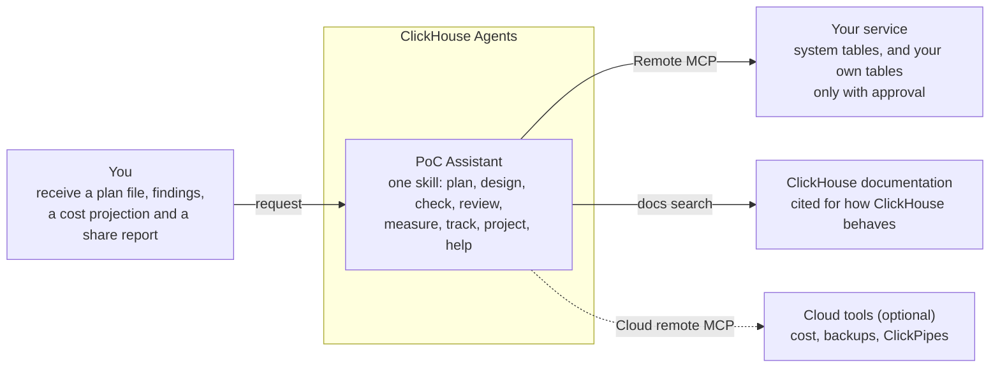

**English** | [日本語](README.ja.md)

# PoC Assistant

**powered by [ClickHouse Agents](https://clickhouse.com/docs/products/cloud/features/ai-ml/agents)**

Run a ClickHouse Cloud proof of concept with evidence, not guesses. 
The agent reads your service's system tables and the official documentation, and answers with the numbers and the sources behind them.

**[Documentation](https://tkykenmt-at-ch.github.io/clickhouse-poc-assistant/index.html)**

> [!NOTE]
> This is an open-source project (Apache-2.0), not a supported ClickHouse product.

## Where it helps

One skill, with a stage for each step of a PoC. Ask in your own words; the agent picks the stage. It also explains its own setup: ask it "What can you do?" or "How do I add an MCP server?".

| 1&nbsp;·&nbsp;Plan | 2&nbsp;·&nbsp;Design | 3&nbsp;·&nbsp;Check | 4&nbsp;·&nbsp;Review | 5&nbsp;·&nbsp;Measure | 6&nbsp;·&nbsp;Track | 7&nbsp;·&nbsp;Project |
|:---:|:---:|:---:|:---:|:---:|:---:|:---:|
| Success criteria and how to measure each | Platform, tables and ingest before you build | The service against the design, and what to do next | Table and query design against best practices | Sizing statistics and load-test comparisons | Daily notes and weekly summaries | Production cost and a report to share |

You build between the design and the check: create the tables, set up ingest and load the data. The agent's connection is read-only; it writes candidates and reads what you built.

<b>The stages behind each step</b>

| Step | Stage | What it does |
|---|---|---|
| Plan | `plan-builder` | Asks about the workload and the environment, proposes success criteria with a measurement method and a public source for each, and writes the PoC plan as Markdown. Pass thresholds are left to you. |
| Design | `architecture-design` | Goes through the platform decisions (deployment, provider and region, connection paths, integrations, security, compute separation, backups) with the conditions and official pages for each, and writes `CREATE TABLE` candidates, objects and the ingest path from your source schema, sample rows and representative queries, with the rule behind each choice. Asks instead of inventing when an input is missing. |
| Check | `fit-gap` | Compares the service with the design during or after the build: tables and keys, column types, views and dictionaries, platform settings, ingest shape, row counts against the source, load errors and freshness. Says what matches, what differs and what is not there yet, and lists the next steps. |
| Review | `schema-query-advisor` | Reviews table design, query patterns and insert shape, and proposes up to five improvement candidates, each with the rule or documentation page behind it and a way to verify it. |
| Measure | `sizing-stats` | Collects sizing statistics (storage, compression, ingest volume and peaks, query load, per-query cost) as a summary and CSV-ready tables. |
| Measure | `load-test-review` | Reviews one load-test window (where latency went, whether the replicas ran out of CPU, rows read against rows returned, autoscaling), or compares two runs before and after a change. |
| Track | `daily-progress` | Daily note: what changed in the last 24 hours, where each success criterion stands, advice on what changed, and next actions, with result lines for the plan. |
| Track | `summary` | Weekly or final summary for the people who decide: each criterion with its evidence and trend, open risks and next steps. |
| Project | `cost-projection` | Monthly list-price projection of a production service from your assumptions, from the PoC's bill and from the public price list, with every formula and rate. Not a quote. |
| Project | `share-report` | A report you can send to your ClickHouse Solutions Architect (SA): findings, aggregate numbers, checks and questions, with no data from your tables and names replaced by labels. |
| Help | `help` | What the agent can do, how to add an MCP server (the ClickHouse Cloud tools or a cloud provider's documentation), fixing a connection, attaching the plan and upgrading. It gives the steps; you click and sign in. |

Two public skills from [ClickHouse/agent-skills](https://github.com/ClickHouse/agent-skills) (Apache-2.0) are used unmodified: `clickhouse-best-practices` (built into ClickHouse Agents) and `clickhouse-architecture-advisor` (bundled in the skill).

## How it works

The agent queries your service over Remote MCP (Model Context Protocol) and cites the documentation.

The Cloud tools are optional: ask the agent how to add the ClickHouse Cloud remote MCP server ([setup guide](https://tkykenmt-at-ch.github.io/clickhouse-poc-assistant/setup.html#optional-mcp-servers)). Without it, the agent points to the Cloud console for cost, backups and ClickPipes.

## What you get

Every answer shows the numbers and the query or documentation page behind them.

<table>
  <tr>
    <th width="33%">Check against the design</th>
    <th width="33%">Load-test review</th>
    <th width="33%">Cost projection</th>
  </tr>
  <tr>
    <td></td>
    <td></td>
    <td></td>
  </tr>
  <tr>
    <td>Each design item: matches, differs or not there yet</td>
    <td>Two runs compared against a success criterion</td>
    <td>Monthly cost from the price list, with every formula</td>
  </tr>
</table>

> [!TIP]
> The [walkthrough](https://tkykenmt-at-ch.github.io/clickhouse-poc-assistant/walkthrough.html) follows one PoC on synthetic data through every step, from the plan to the share report.

## Guardrails

| Guardrail | What it means |
|---|---|
| 🔎 **Evidence, not guesses** | Numbers come from system tables; statements about how ClickHouse behaves cite the official documentation. |
| 🔐 **Your tables only with approval** | Before it queries your own tables, the agent shows the queries with their `EXPLAIN ESTIMATE` and asks. It returns aggregates, not rows. |
| 🚫 **No size, tier or price advice** | A cost projection uses your assumptions and is not a quote. |
| 🤖 **Generative AI terms** | Query results are processed by the model under the Generative AI features terms your organization accepts when it turns the features on. |
| 📤 **You decide what is shared** | The share report leaves out table data and names; you check it and send it yourself. |

## Get started

1. **Prepare the service**: turn on Remote MCP and Generative AI features on the service.
2. **Create the agent**: upload `poc-assistant-skill.zip` from the [latest release](https://github.com/tkykenmt-at-ch/clickhouse-poc-assistant/releases/latest) and create the agent.
3. **Ask for a plan**: and attach the plan file to the agent.

Step by step: [setup guide](https://tkykenmt-at-ch.github.io/clickhouse-poc-assistant/setup.html)

## Status

- Since v0.6.0 the agent is one skill (`poc-assistant`) with a file per stage. In ClickHouse Agents (2026-10-19), requests in English and Japanese loaded the right stage for the plan (with its new `## Setup` section), the design with the bundled `clickhouse-architecture-advisor` rules, the check against the design, the cost projection and the help stage (what the agent can do, adding the AWS and Google documentation servers, and a pasted secret, which it did not use or repeat). The earlier stages were not rerun after the move; their text did not change apart from stage names and, in the daily note and the summary, one line on unchecked `## Setup` items.
- The whole flow, from plan through design, build and check to share report, was run in ClickHouse Agents in English and Japanese on a test service with synthetic data (2026-10-17); the build was done with `clickhouse-client`, with two deliberate mistakes that the check found; see the [walkthrough](https://tkykenmt-at-ch.github.io/clickhouse-poc-assistant/walkthrough.html).
- All queries pass on ClickHouse 26.7 and 26.8 as a least-privilege user (`scripts/test-queries.sh`, run by CI), and run without errors on a ClickHouse Cloud (26.6) test service.
- Not used: ClickHouse Agents memory (manually created memories did not reach the agent in testing), scheduled chats (creating a schedule for an agent with the ClickHouse tool kept asking to reconnect the MCP server), and the Agent API (not available). Ask the agent for the daily note and the weekly review.
- What changed and how each change was tested: [Releases](https://github.com/tkykenmt-at-ch/clickhouse-poc-assistant/releases). Known problems and planned work: [Issues](https://github.com/tkykenmt-at-ch/clickhouse-poc-assistant/issues).

## Development

Repository layout, how to build and test the zips, and the conventions every query follows: [Development](https://tkykenmt-at-ch.github.io/clickhouse-poc-assistant/development.html).
