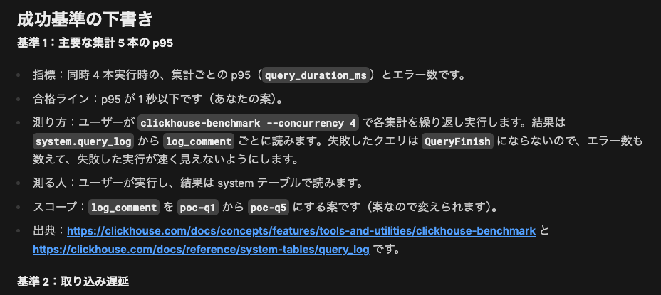
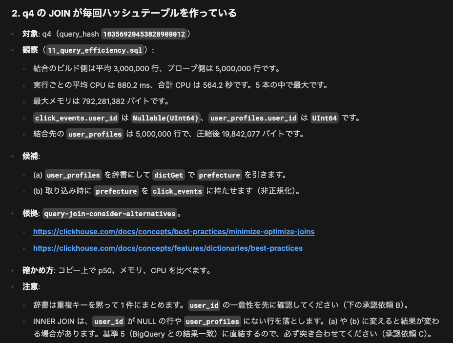
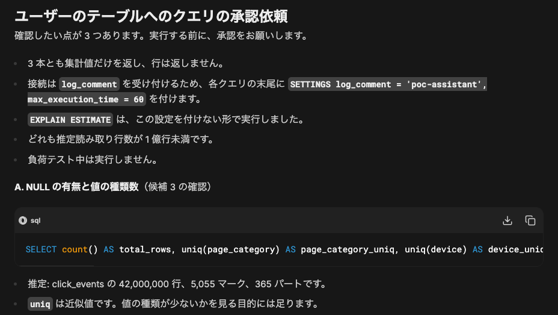
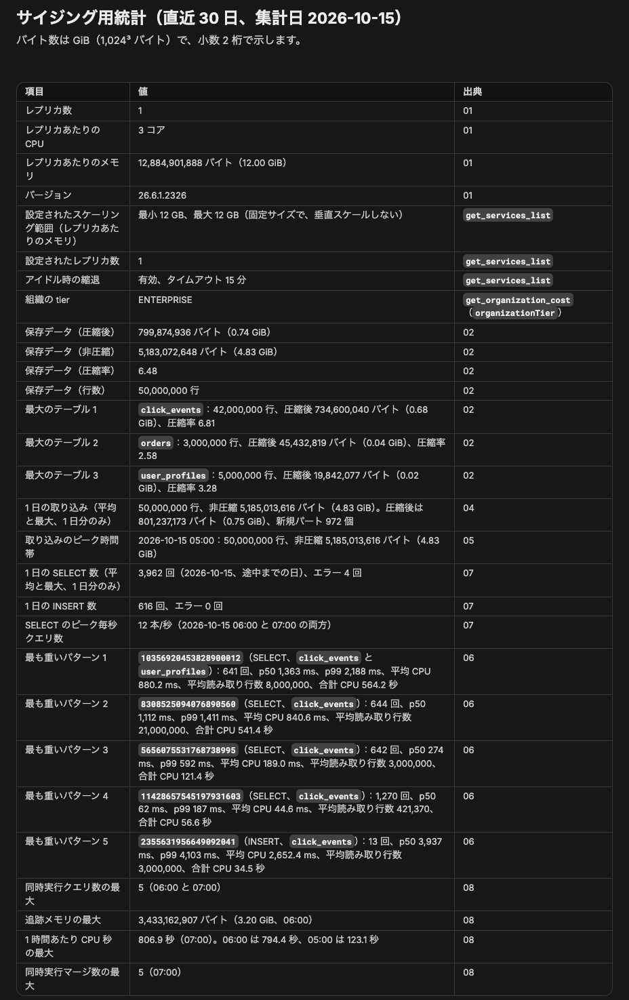
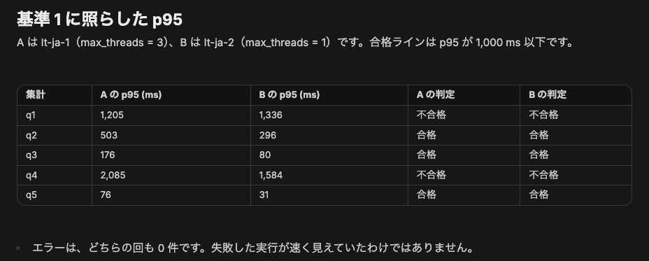
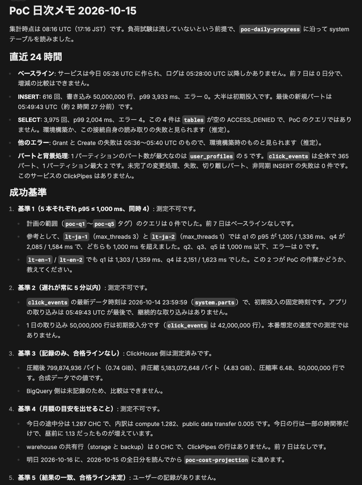
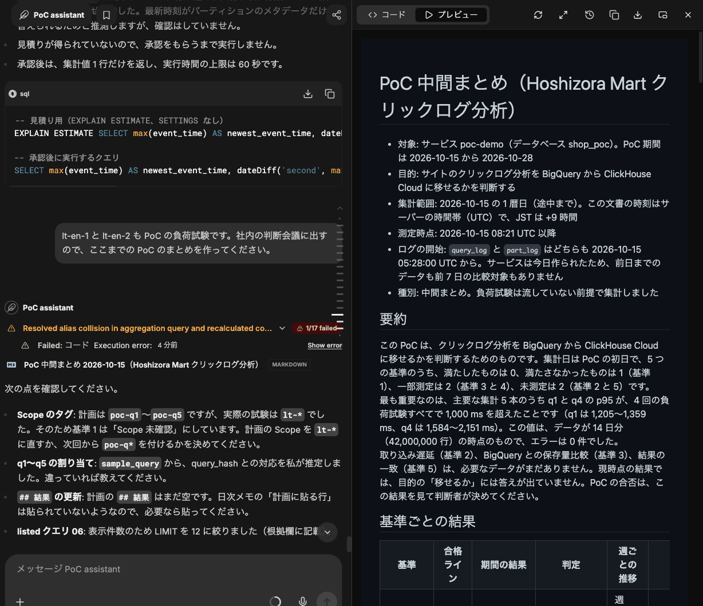
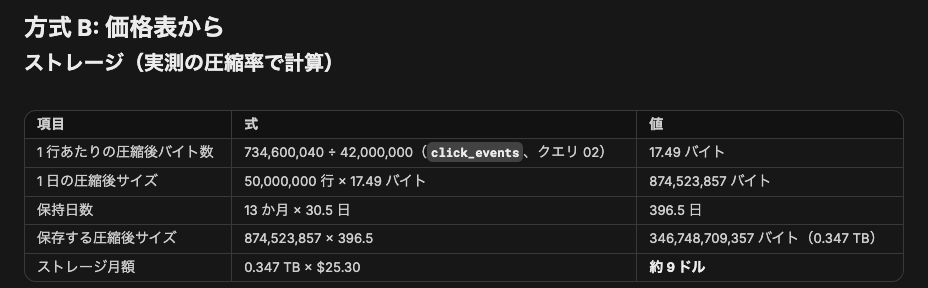
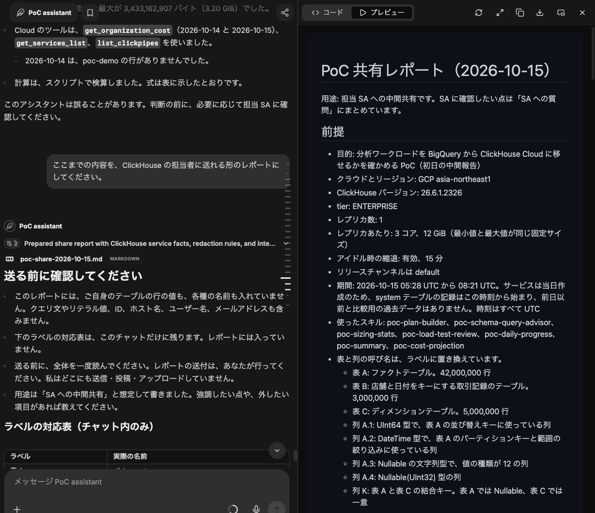

# 通しの手順：計画から共有レポートまで

[English](walkthrough.md)

PoC アシスタントで PoC を 1 件進める流れを、ClickHouse Agents の画面とともに段ごとに追います。
**会社名の Hoshizora Mart は架空のもので、データはすべて合成データです。**
データはテスト用のサービス `poc-demo` で SQL から作りました。
画面は 2026-10-15 に撮ったもので、回答の言い回しは実行のたびに変わります。

想定する PoC は次のとおりです。
Hoshizora Mart は、サイトのクリックログ分析を BigQuery から ClickHouse Cloud に移せるかを、2 週間の PoC で確かめます。
データはデータベース `shop_poc` にあります。

- `click_events`：閲覧の記録（ファクトテーブル）
- `user_profiles`：利用者ごとに 1 行（ディメンションテーブル）
- `orders`：店舗ごとの注文

先にエージェントを用意します（[setup.ja.md](setup.ja.md)）。
以下の依頼はすべて同じチャットで行います。
スキル名を言う必要はありません。

## 1. PoC を計画する（`poc-plan-builder`）

**頼み方**：目的と、考えている成功基準を自分の言葉で伝えます。

> 架空の EC 事業者 Hoshizora Mart で、サイトのクリックログ分析を BigQuery から ClickHouse Cloud に移せるかを 2 週間の PoC で確かめたいです。対象はサービス poc-demo のデータベース shop_poc です。成功基準は次の 4 つを考えています。(1) 主要な集計 5 本の p95 が同時 4 本で 1 秒以下 (2) … PoC の計画にまとめてもらえますか。

エージェントが `poc-plan-builder` を選びます。

エージェント名の下の進み具合の行（「Loaded poc-plan-builder skill …」など）は、ClickHouse Agents 側が道具の手順を要約した表示で、スキルの出力ではありません。
日本語で頼んでも英語で出ます。

**返ってくるもの**：system テーブルから読んだサービスの現状と、成功基準ごとの指標、測り方、測る人、公開資料の出典です。
合格ラインが決まっていない基準は、質問として返ってきます。

**次にすること**：質問に答えると、エージェントが `poc-plan-<名前>.md` を書きます。
このファイルをエージェントのファイルコンテキストに添付します（[setup.ja.md の 5](setup.ja.md#5-poc-の計画を作って添付する)）。
他のスキルは、ここから成功基準を読みます。

## 2. テーブルとクエリを見直す（`poc-schema-query-advisor`）

**頼み方**：

> 計画ファイルを添付しました。負荷をかける前に、shop_poc のテーブル設計と、これまでに流したクエリを見直してもらえますか。直したほうがよい点があれば、根拠と確かめ方も付けてください。

**返ってくるもの**：最大 5 件の改善候補です。
それぞれに、system テーブルで観察したこと、根拠のルールやドキュメント、確かめ方が付きます。
この例では、都道府県別の閲覧数の集計が、実行のたびに 3,000,000 行のハッシュテーブルを作っていることが候補に挙がりました。
直し方の候補は、辞書で引く方法と、取り込み時に列を持たせる方法（非正規化）です。

自分のテーブルで確かめるクエリは、`EXPLAIN ESTIMATE` の見積もりとともに先に示され、承認を求められます。
返すのは集計値だけです。

**次にすること**：承認するか断ります。
改善候補はテスト用のコピーで確かめるためのもので、決定ではありません。

## 3. サイジングの統計と負荷試験（`poc-sizing-stats`、`poc-load-test-review`）

**頼み方**：

> サイズを考える材料として、poc-demo の使われ方の統計をまとめてもらえますか。

**返ってくるもの**：サイジングの統計の表と、クエリごとの CSV です。

負荷試験は自分で流し、`log_comment` でタグを付けてから、見方を頼みます。
この例では 2 回流しました。
1 回目は既定の設定、2 回目は設定を 1 つだけ変えています（`max_threads = 1`）。

> 日本語側の負荷試験は 2 回です。15:17〜15:19 に log_comment = 'lt-ja-1' で同時 4 本を 2 分、15:20〜15:22 に 'lt-ja-2' で同じ条件のまま max_threads を 1 に変えて流しました（時刻は JST）。いまは何も流していません。2 回の結果を比べて、基準 1 に照らしてどう読めばよいか教えてください。

**返ってくるもの**：基準に照らしたクエリごとの p95 と、時間の使われ方（CPU、CPU の待ち、I/O）です。
比較が公平だったか（設定が実際に変わったか、キャッシュの状態、実行の順序）も確かめます。

**次にすること**：この例の 2 回は計画のタグではなく `lt-*` のタグなので、エージェントは基準の結果として数えません。
計画のタグで流し直すか、計画のほうを直します。

## 4. 日次メモとまとめ（`poc-daily-progress`、`poc-summary`）

**頼み方**：

> 今日の進み具合を日次メモにしてください。明日やることも挙げてください。

**返ってくるもの**：直近 24 時間の変化、成功基準ごとの状況、変化に限った助言、次にやることです。
計画の `## 結果` に貼る行も付きます。

会議に出すときは、まとめを頼みます。

> 社内の判断会議に出すので、ここまでの PoC のまとめを作ってください。

まとめは Markdown の文書で、チャットの横に開きます。

## 5. 費用の試算と共有レポート（`poc-cost-projection`、`poc-share-report`）

**頼み方**：

> 本番の月額費用の目安も出してもらえますか。前提は計画のとおり、1 日 5,000 万行、保持 13 か月、平日 9〜18 時に同時 10 本です。

**返ってくるもの**：式と単価をすべて示した、定価ベースの試算です。
見積りではなく、サイズもエージェントは決めません。
入力のない項目は合計に入れません（この例ではコンピュートで、レプリカ数とメモリが必要です）。

判断に使う出力（まとめ、費用の試算、共有レポート）の末尾には、アシスタントが誤ることがあるという 1 行が付きます。

ClickHouse の担当者に共有するときは、次のように頼みます。

> ここまでの内容を、ClickHouse の担当者に送れる形のレポートにしてください。

**返ってくるもの**：発見事項、集計値、確認方法、SA への質問をまとめたレポートです。
テーブル名、列名、サービス名はラベルに置き換わり、ラベルとの対応表はチャットにだけ残ります。

**次にすること**：送る前にレポートを読みます。
エージェントは送信しません。
