# 通しの手順：計画から共有レポートまで

[English](walkthrough.md)

PoC アシスタントで PoC を 1 件進める流れを、ClickHouse Agents の画面とともに段ごとに追います。
**会社名の Aozora Logistics は架空のもので、データはすべて合成データです。**
データはテスト用のサービス `poc-demo` で SQL から作りました。
画面は 2026-10-17 に撮ったもので、回答の言い回しは実行のたびに変わります。

想定する PoC は次のとおりです。
Aozora Logistics は、荷物の追跡イベントの分析と、追跡 API の裏側を、今のデータウェアハウスから ClickHouse Cloud に移せるかを、3 週間の PoC で確かめます。
今のデータウェアハウスは毎日 Parquet を S3 に書き出し、新しいイベントは Amazon MSK に流れています。
PoC のデータは、空の新しいデータベース `aozora_ja` に入れます。

- `shipment_events`：追跡イベントごとに 1 行（14 日分、1 日 400,000 行）
- `depots`：拠点ごとに 1 行（120 行）

先にエージェントを用意します（[setup.ja.md](setup.ja.md)）。
以下の依頼は自分の言葉で伝えればよく、スキル名を言う必要はありません。
チャットは 1 つのままでも、後の段で新しく始めてもかまいません。
次の段に要ることは、添付した計画と設計のファイルが受け渡します。

## 1. PoC を計画する（`poc-plan-builder`）

**頼み方**：目的と、気にしていることを自分の言葉で伝えます。

> Aozora Logistics は架空の宅配会社です。荷物の追跡イベントの分析と、追跡 API の裏側を、今のデータウェアハウスから ClickHouse Cloud に移せるかを、3 週間の PoC で確かめたいです。本番の量は 1 日およそ 1,200 万イベントで、400 日保持します。… PoC の計画にまとめてもらえますか。

エージェントが `poc-plan-builder` を選びます。

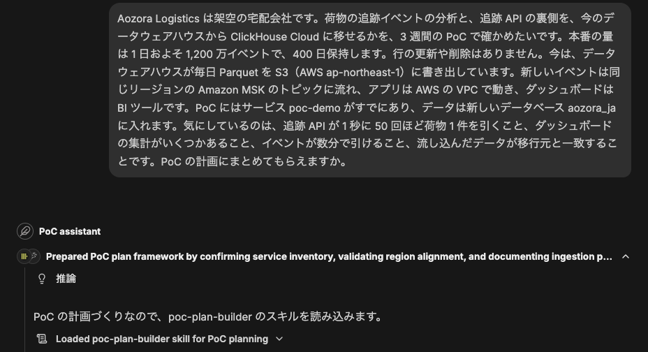

エージェント名の下の進み具合の行（「Loaded poc-plan-builder skill …」など）は、ClickHouse Agents 側が道具の手順を要約した表示で、スキルの出力ではありません。
日本語で頼んでも英語で出ます。

**返ってくるもの**：system テーブルから読んだサービスの現状と、成功基準ごとの測り方と公開資料の出典、そして質問です。
質問は、まだ決まっていない合格ラインと、環境のうち決まっていないところについてです。
環境は、プロバイダとリージョン、リリースチャネル、Remote MCP と生成 AI の機能が有効か、試験の通信にどう印を付けるか、です。
この例では、PoC のサービスが GCP にあり、データが AWS にあることも指摘されました。

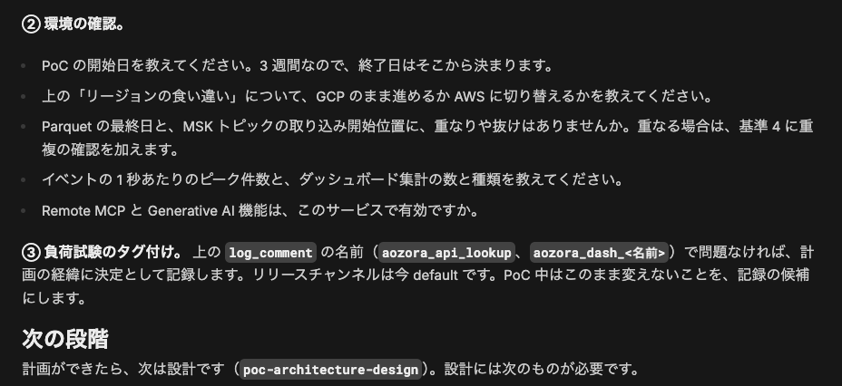

**次にすること**：質問に答えると、エージェントが `poc-plan-<名前>.md` を書き、次は設計の段だと案内します。
計画をエージェントのファイルコンテキストに添付します（[setup.ja.md の 5](setup.ja.md#5-poc-の計画を作って添付する)）。

## 2. 基盤とテーブルを設計する（`poc-architecture-design`）

**頼み方**：

> 計画ファイルを添付しました。次に、この PoC のアーキテクチャと表の設計を考えてもらえますか。

移行元のスキーマとクエリがないうちは、エージェントは表をでっち上げません。
基盤の層（デプロイ、接続、取り込みの経路、セキュリティ、バックアップ）を、判断ごとに何で分かれるかと出典を付けて書きます。
そのうえで、表を決める材料を求めます。
移行元のスキーマ、数行のサンプル、代表的なクエリ 5 本ほどです。
サンプルは本物でなく、ダミーかマスクした値にするよう伝えます。

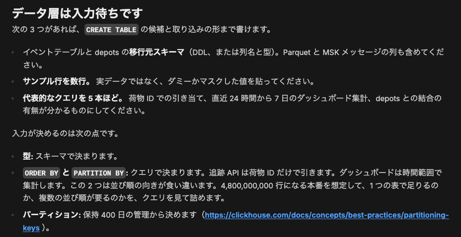

貼ると、`CREATE TABLE` の候補が返ってきます。
`ORDER BY`、`PARTITION BY`、型の選択ごとに、根拠のルールやページと、決め手になったクエリや回答が付きます。

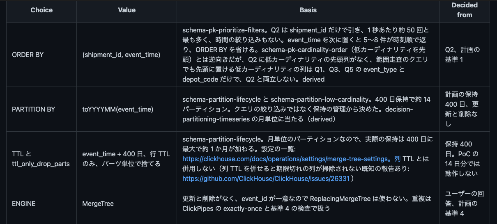

設計は `poc-design-<名前>.md` というファイルになります。
計画の隣に添付します。
クラウドプロバイダ側の事実は、プロバイダのドキュメントの MCP をつないでいればそれで調べ、送るのは一般的な問いだけです（つなぎ方は [setup.ja.md の 4](setup.ja.md#4-エージェントを作る)）。
この回はつないでおらず、エージェントは公式ページの URL を示しました。

**次にすること**：構築します。
構築は利用者の作業で、エージェントの接続は読み取り専用です。
この例では `clickhouse-client` で表を作り、ダミーのデータを 13 日分流し込みました。
わざと 2 つ間違えています。
`shipment_events` を時刻先頭（`ORDER BY (event_time, shipment_id)`）で作り、2026-10-09 を入れていません。

## 3. 設計と照らし合わせる（`poc-fit-gap`）

**頼み方**：構築の途中でも後でも、何度でも頼めます。
表を作っただけの時点では、こう頼みました。

> 設計どおりにできているか見てください。aozora_ja に表を作ったところです。流し込みはまだで、測定もしていません。今は何も動いていません。

**返ってくるもの**：設計の項目ごとに 1 行の表です。
設計が期待する値、いまのサービスの値、状態（合っている、違う、まだない、未確認）、読んだクエリが並びます。
違う項目には、「設計を変える」と「構築を直す」の両方の候補が出典付きで付き、次の手順が順番に並びます。

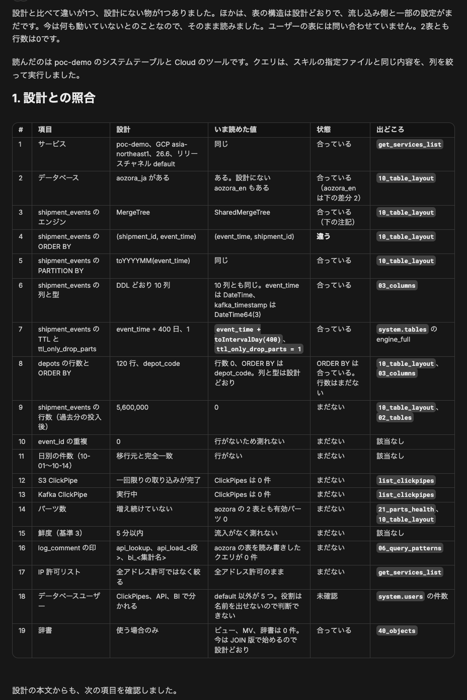

流し込んだあとは、移行元の件数を伝えて頼み直します。
自分のテーブルの日別の件数を数えるクエリは、`EXPLAIN ESTIMATE` の見積もりとともに先に示され、承認を待ちます。
承認すると、足りない日を特定します。

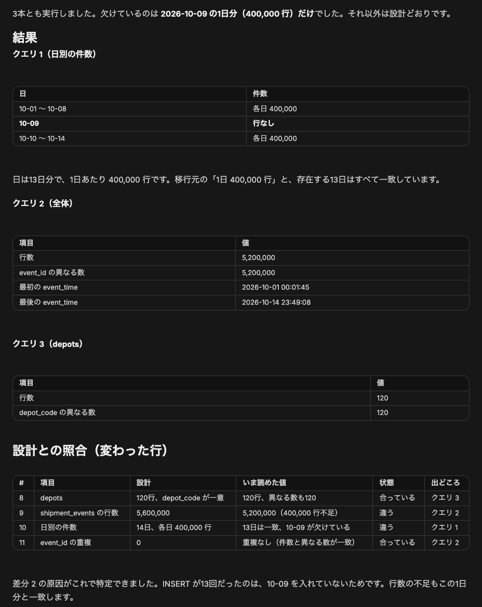

**次にすること**：直すと決めたものを直します（この例では 2026-10-09 を入れる）。
提案された行を、計画の `## 結果` と `## 経緯` に貼ります。

## 4. テーブルとクエリを見直す（`poc-schema-query-advisor`）

**頼み方**：代表クエリに `log_comment` の印を付けて流してから頼みます。

> 設計の log_comment を付けて、代表クエリを 5 回ずつ流しました。今は何も動いていません。スキーマとクエリを見直してください。

**返ってくるもの**：最大 5 件の改善候補です。
それぞれに、system テーブルで観察したこと、根拠のルールやドキュメント、確かめ方、設計との関係が付きます。
この例では、荷物 1 件引きが時刻先頭の並びで表のマークの平均約半分を読んでいたことと、返った行が毎回 0 行だったこと（試験に使った荷物 ID が実在しなかった）が挙がりました。

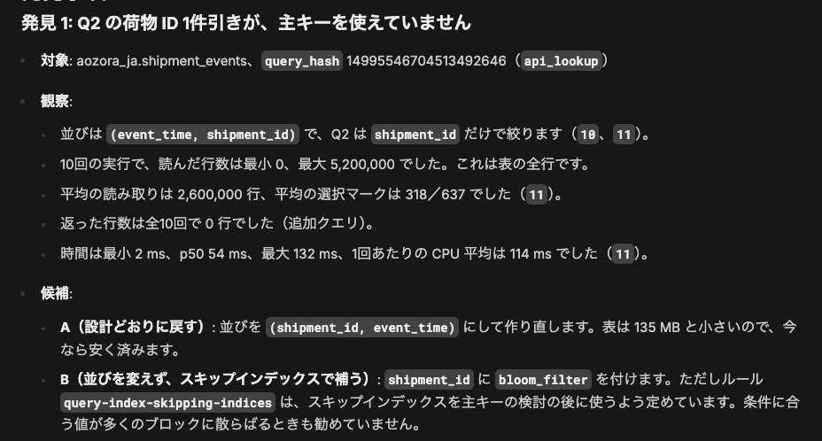

**次にすること**：候補は確かめる対象で、決定ではありません。
この例では、設計の `ORDER BY` で表を作り直し、古い表を `shipment_events_old` として残しました。

## 5. サイジングの統計と負荷試験（`poc-sizing-stats`、`poc-load-test-review`）

**頼み方**：

> 計画と設計を添付しました。サイジングに使えるように、poc-demo の利用統計をまとめてください。…

エージェントは先に、負荷試験が動いていないかと、どの期間を使うかを確かめます（この例では依頼に書きました）。
そのうえでサイジング用のクエリを流し、結果ごとに CSV を出します。

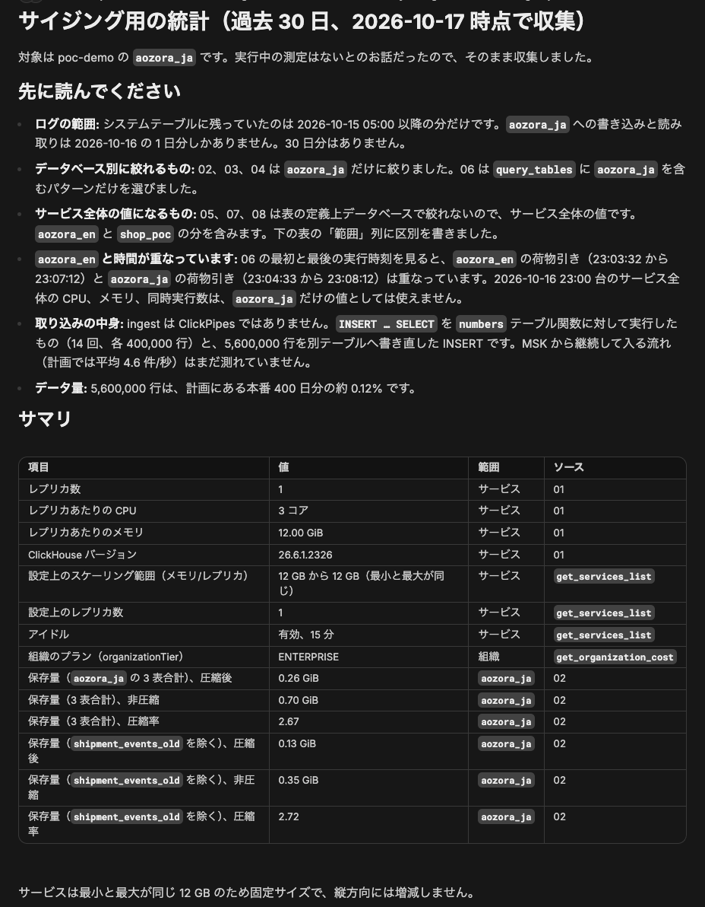

続けて自分で負荷試験を流し、`log_comment` で印を付けて、見直しを頼みます。
この例では、荷物 1 件引きを同時 20 本で 60 秒ずつ、古い時刻先頭の表と作り直した表で 1 回ずつ流しました。

> … api_load_1 は古い表で 2026-10-16 23:04:32〜23:05:32 UTC、api_load_2 は作り直した表で 23:07:12〜23:08:12 UTC です。… 2 回の結果を比べて、基準 1 に照らした読み方を教えてください。

**返ってくるもの**：基準に照らした回ごとの p95、時間の内訳（CPU、CPU 待ち、I/O）、比べ方が公平だったか（キャッシュの状態、ほかに変わったもの）です。

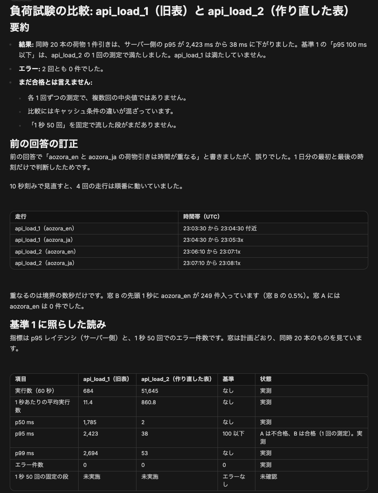

**次にすること**：試験が基準に数えられるかは、計画のその基準の範囲にある印で決まります。
この例の計画では、基準 1 の範囲に `api_load_<段>` も入っています。
そのため作り直した表の 1 回は「暫定で満たした」と読まれましたが、合格とはされていません。
測定が 1 回だけで、キャッシュの条件も揃っておらず、1 秒 50 回の段もまだないからです。
条件を揃えて繰り返し測ります。

## 6. 日次のまとめと全体のまとめ（`poc-daily-progress`、`poc-summary`）

**頼み方**：

> 今日の日報を、明日やることも含めて書いてください。

**返ってくるもの**：直近 24 時間の動き、成功基準ごとの状況、変わった点だけの新しい助言、次にやることです。
計画の `## 結果` に貼る行も付きます。

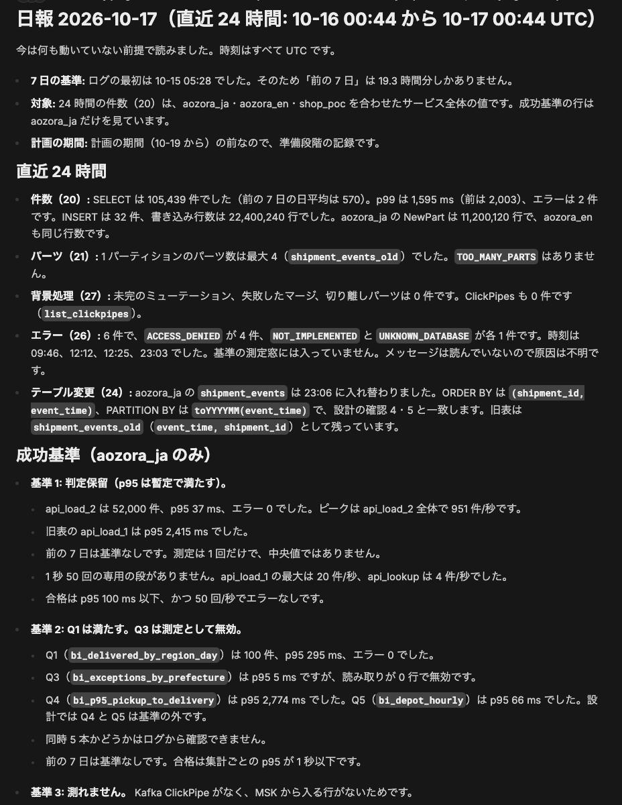

会議に出すときは、全体のまとめを頼みます。

> 社内の判断会議にかけます。ここまでの PoC のまとめを書いてください。

まとめは、チャットの横に開く Markdown の文書です。

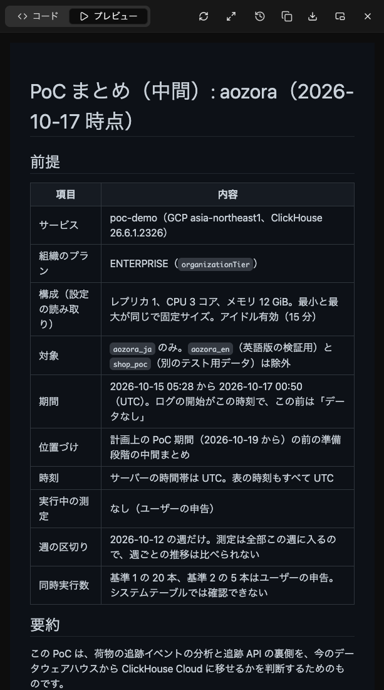

## 7. 費用の試算と共有レポート（`poc-cost-projection`、`poc-share-report`）

**頼み方**：

> 本番の月額の目安も出せますか。前提は計画と同じで、1 日 1,200 万イベント、保持 400 日、追跡 API は 24 時間、ダッシュボードは平日 9〜18 時（JST）です。

**返ってくるもの**：価格表からの試算で、式と単価がすべて付きます。
見積もりではなく、規模もエージェントは選びません。
入力がない行（この例ではコンピュートに要るレプリカ数とメモリ）は合計に入れません。

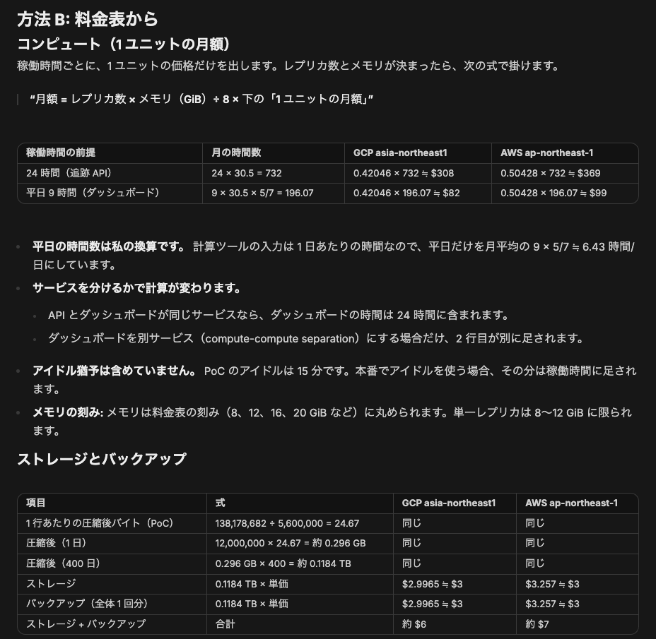

判断に使う出力（全体のまとめ、費用の試算、共有レポート）の最後には、誤ることがあるという 1 行が付きます。

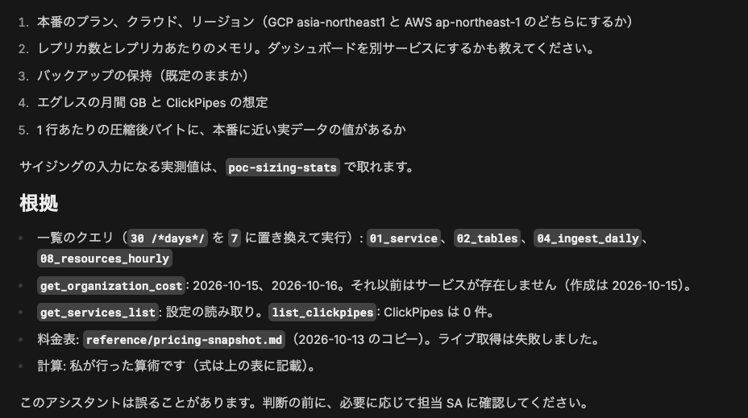

ClickHouse の担当者に共有するときは、こう頼みます。

> ここまでの内容を、ClickHouse の担当者に送れるレポートにしてください。

**返ってくるもの**：所見、集計値、確認したこと、SA への質問をまとめたレポートです。
テーブル名、列名、サービス名はラベルに置き換えられ、ラベルの対応表はチャットの中にだけ残ります。

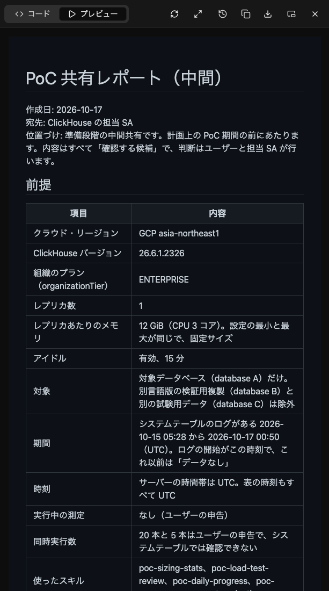

**次にすること**：送る前にレポートを読みます。
エージェントは送りません。
