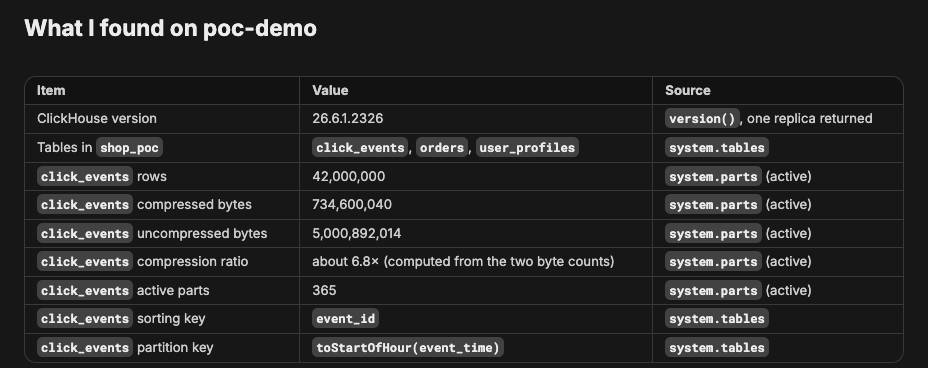
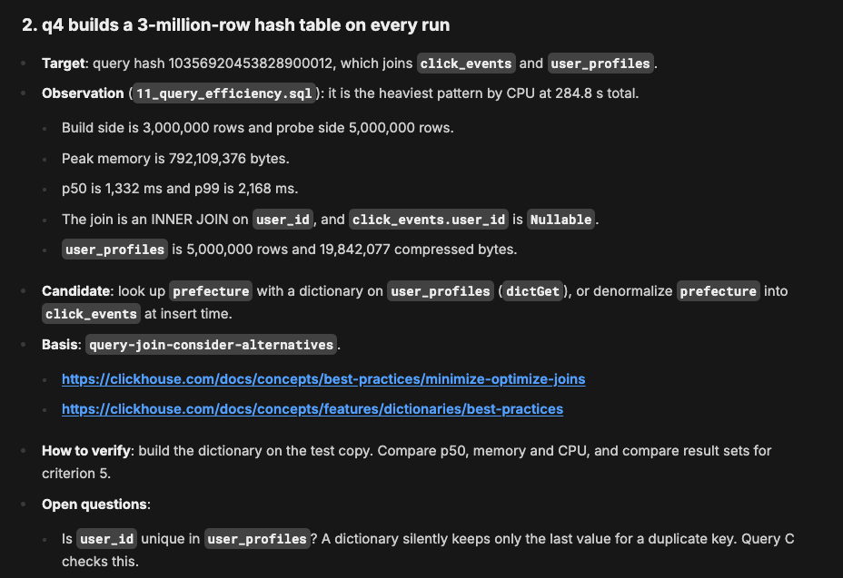
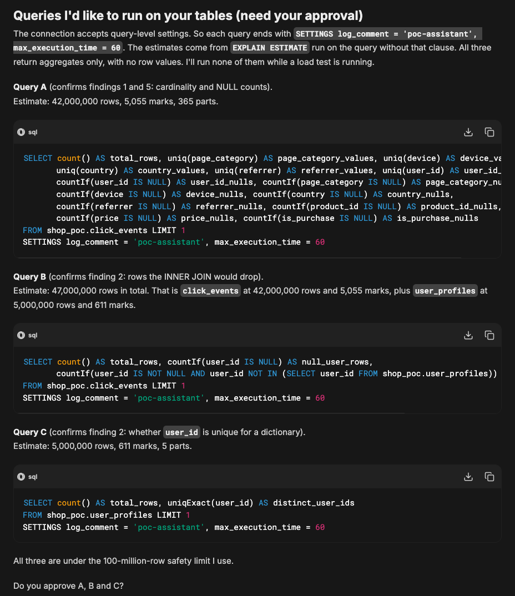
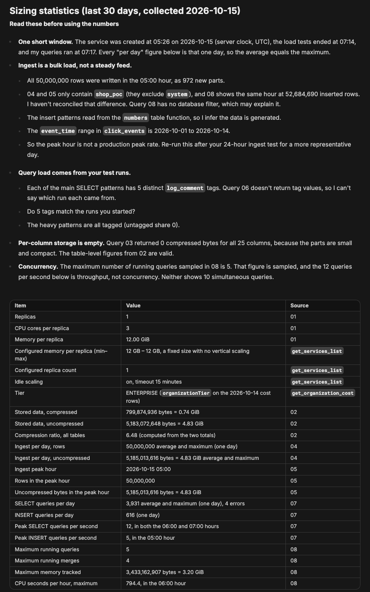
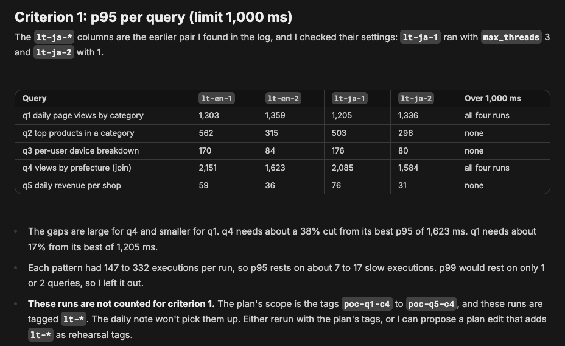
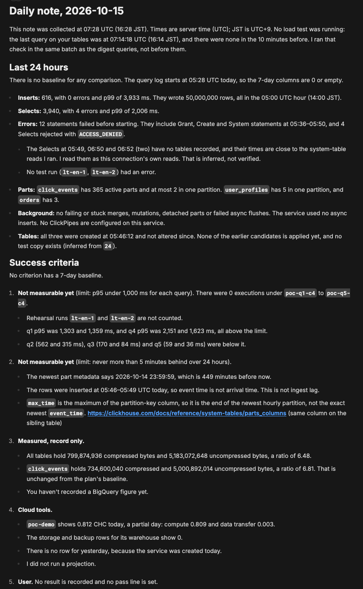
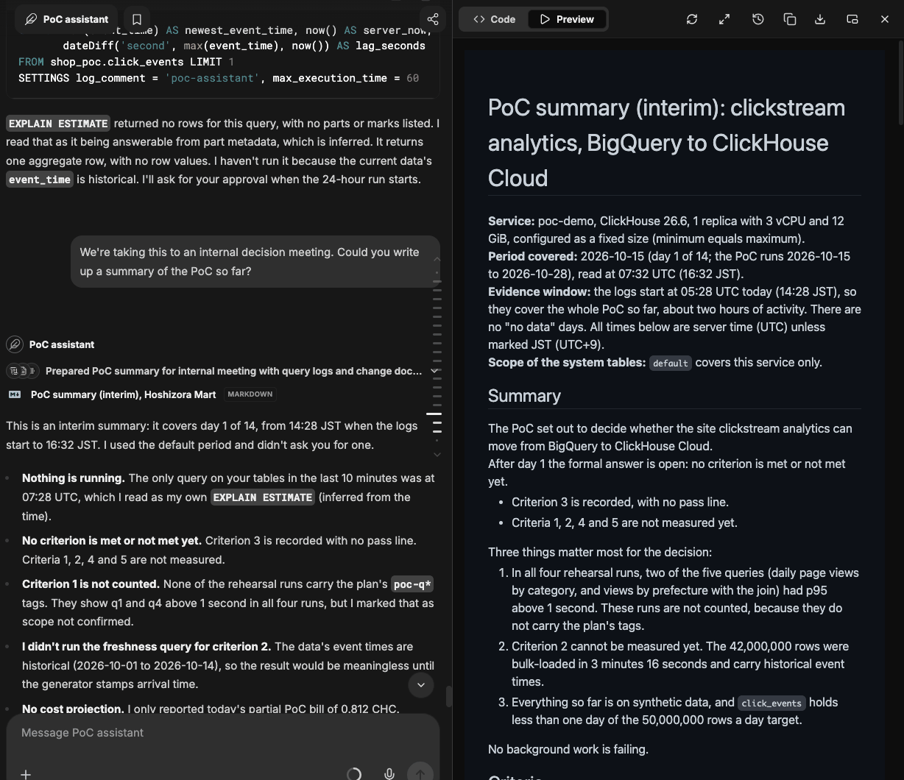
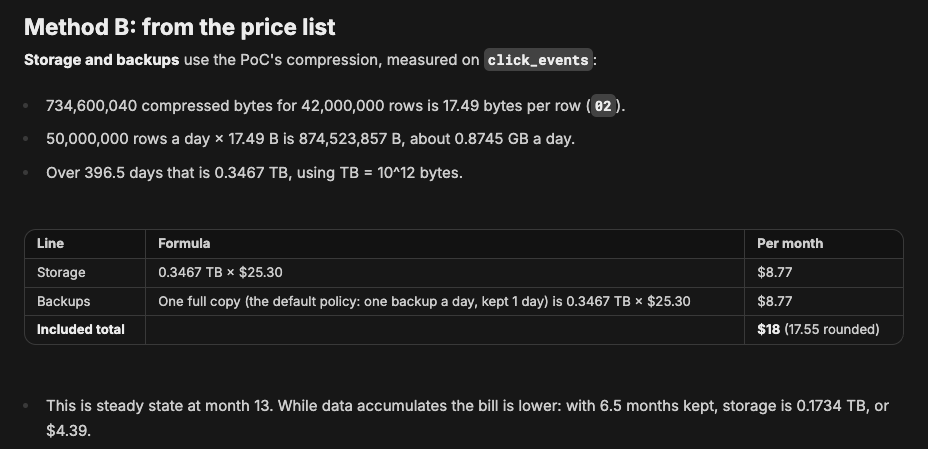
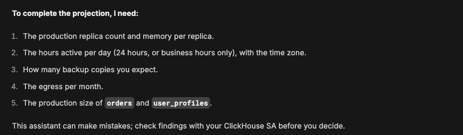
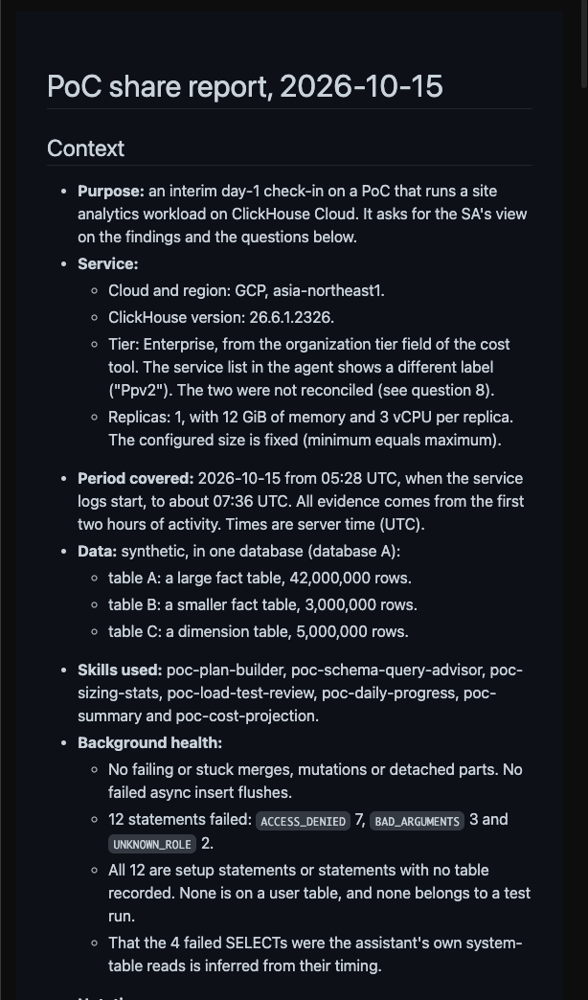

# Walkthrough: one PoC from plan to share report

[日本語](walkthrough.ja.md)

This page follows one PoC through the PoC assistant, step by step, with screenshots from ClickHouse Agents. **The company, Hoshizora Mart, is fictional, and all data is synthetic**, generated with SQL on a test service named `poc-demo`. The screenshots were taken on 2026-10-15; the wording of each answer differs from run to run.

The scenario: Hoshizora Mart wants to know, in a two-week PoC, whether it can move its site clickstream analytics from BigQuery to ClickHouse Cloud. The data is in the database `shop_poc`:

- `click_events`: page views (fact table)
- `user_profiles`: one row per user (dimension table)
- `orders`: orders per shop

Set up the agent first ([setup.md](setup.md)). Every step below is a request in the same chat; you do not need to name the skill.

## 1. Plan the PoC (`poc-plan-builder`)

**Ask**, in your own words, with the goal and the criteria you have in mind:

> Hoshizora Mart is a fictional online retailer. We want a two-week PoC to see whether we can move our site clickstream analytics from BigQuery to ClickHouse Cloud. The data is in database shop_poc on the service poc-demo. We have four success criteria in mind: (1) p95 of our five main aggregations is under 1 second at 4 concurrent queries, (2) … Could you turn this into a PoC plan?

The agent picks `poc-plan-builder`:

The lines under the agent's name (for example "Loaded poc-plan-builder skill …") are ClickHouse Agents' own summary of the tool steps, not the skills' output; they appear in English even when you write in another language.

**What comes back:** what the service holds now, read from system tables, then each criterion with a measurement method, who measures it and a public source, and questions for the pass thresholds it still needs.

**Next:** answer the questions. The agent writes `poc-plan-<name>.md`. Attach it to the agent as file context ([setup.md, step 5](setup.md#5-plan-the-poc-and-attach-the-plan)), so the other skills can read the criteria.

## 2. Review the tables and queries (`poc-schema-query-advisor`)

**Ask:**

> I've attached the plan file. Before we load test, could you review the table design in shop_poc and the queries we've run so far? For anything worth changing, include the evidence and how to check it.

**What comes back:** up to five candidates, each with what was observed in system tables, the rule or documentation page behind it, and how to verify it. Here, one of them is the join: each run of the views-by-prefecture query builds a 3,000,000-row hash table, and the candidates are a dictionary lookup or denormalizing the column at insert time.

To confirm a finding on your own tables, the agent first shows the queries with their `EXPLAIN ESTIMATE` and asks for approval. They return aggregates only.

**Next:** approve or decline. The candidates are things to verify on a test copy, not decisions.

## 3. Sizing statistics and load tests (`poc-sizing-stats`, `poc-load-test-review`)

**Ask:**

> Could you pull together usage statistics for poc-demo that we can use for sizing?

The agent first asks whether a load test is running and which period to use, then runs the sizing queries and offers each result as a CSV.

Then run a load test yourself, tag it with `log_comment`, and ask for a review. Here two runs were made: one with default settings and one with a single setting changed (`max_threads = 1`).

> For the English side we ran two: lt-en-1 from 16:09 to 16:11 JST at 4 concurrent queries with default settings, and lt-en-2 from 16:12 to 16:14 JST under the same conditions but with max_threads set to 1. Could you compare the two runs and tell me how to read them against criterion 1?

**What comes back:** p95 per query against the criterion, where the time went (CPU, waiting for CPU, I/O), and whether the comparison was fair (the setting really changed, the cache state, the run order).

**Next:** the runs here carry `lt-*` tags rather than the plan's tags, so the agent does not count them toward the criterion. Rerun with the plan's tags, or change the plan.

## 4. Daily note and summary (`poc-daily-progress`, `poc-summary`)

**Ask:**

> Please write today's daily note, with what we should do tomorrow.

**What comes back:** the last 24 hours, where each criterion stands, new advice (only for what changed) and the next actions, plus result lines to paste into the plan's `## Results`.

For a meeting, ask for a summary:

> We're taking this to an internal decision meeting. Could you write up a summary of the PoC so far?

The summary is a Markdown document that opens beside the chat:

## 5. Cost projection and share report (`poc-cost-projection`, `poc-share-report`)

**Ask:**

> Can you also give us a rough monthly cost for production? Same assumptions as the plan: 50 million rows a day, 13 months retention, 10 concurrent queries on weekdays from 9:00 to 18:00.

**What comes back:** a list-price projection with every formula and rate. It is not a quote, and the agent does not choose a size: lines it has no input for (here compute, which needs the replica count and memory) stay out of the total.

Decision outputs (summary, cost projection, share report) end with a one-line note that the assistant can make mistakes:

To share with your ClickHouse contact:

> Could you turn what we have so far into a report I can send to our ClickHouse contact?

**What comes back:** a report with findings, aggregate numbers, checks and questions for the SA. Table, column and service names are replaced by labels, and the label mapping stays in the chat only.

**Next:** read the report before you send it; the agent does not send it.
