# Walkthrough: one PoC from plan to share report

[日本語](walkthrough.ja.md)

This page follows one PoC through the PoC assistant, step by step, with screenshots from ClickHouse Agents. **The company, Aozora Logistics, is fictional, and all data is synthetic**, generated with SQL on a test service named `poc-demo`. The screenshots were taken on 2026-10-17; the wording of each answer differs from run to run.

The scenario: Aozora Logistics wants to know, in a three-week PoC, whether its parcel tracking analytics and the back end of its tracking API can move from its current data warehouse to ClickHouse Cloud. Today the warehouse exports Parquet files to S3 every day and new events flow through Amazon MSK. The PoC data goes into a new, empty database `aozora_en`:

- `shipment_events`: one row per tracking event (14 days, 400,000 events a day)
- `depots`: one row per depot (120 rows)

Set up the agent first ([setup.md](setup.md)). Each step below is a request in plain words; you do not need to name the skill. You can keep one chat or start a new one for a later stage: the plan and design files you attach carry what the next stage needs.

## 1. Plan the PoC (`poc-plan-builder`)

**Ask**, in your own words, with the goal and what you care about:

> Aozora Logistics is a fictional parcel delivery company. We want a three-week PoC to decide whether parcel tracking analytics and the back end of our tracking API can move from our current data warehouse to ClickHouse Cloud. Production volume is about 12 million tracking events a day, kept for 400 days … Could you turn this into a PoC plan?

The agent picks `poc-plan-builder`:

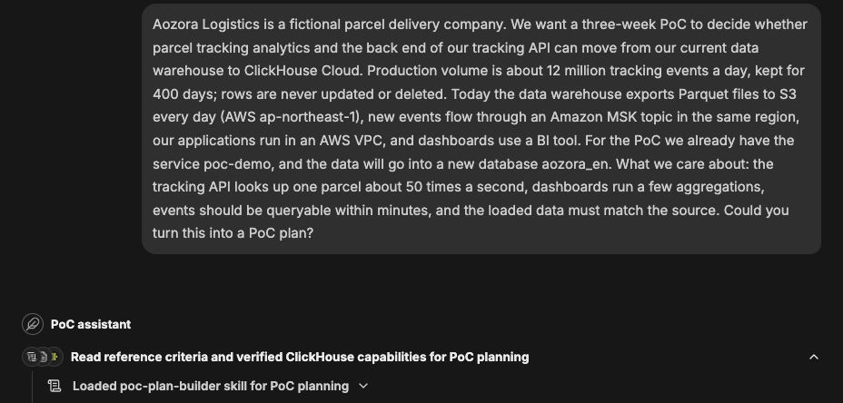

The lines under the agent's name (for example "Loaded poc-plan-builder skill …") are ClickHouse Agents' own summary of the tool steps, not the skills' output; they appear in English even when you write in another language.

**What comes back:** what the service holds now, read from system tables, each criterion with a measurement method and a public source, and questions for what it still needs: the pass thresholds, and the parts of the environment that are not settled (provider and region, release channel, whether Remote MCP and Generative AI features are on, how test traffic will be tagged). Here it also pointed out that the PoC service runs on GCP while the data sits in AWS.

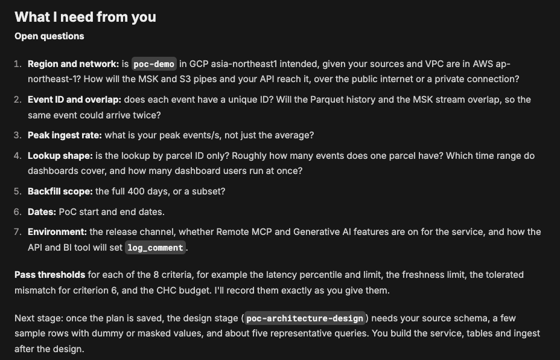

**Next:** answer the questions. The agent writes `poc-plan-<name>.md` and points to the design stage. Attach the plan to the agent as file context ([setup.md, step 5](setup.md#5-plan-the-poc-and-attach-the-plan)).

## 2. Design the platform and the tables (`poc-architecture-design`)

**Ask:**

> I've attached the plan file. Next, could you design the architecture and the tables for this PoC?

Without a source schema and queries, the agent does not invent tables. It writes the platform layer (deployment, connections, ingest paths, security, backups), each decision with what it depends on and a source, and asks for what decides the tables: the source schema, a few sample rows and about five representative queries. It asks for dummy or masked values, not real data.

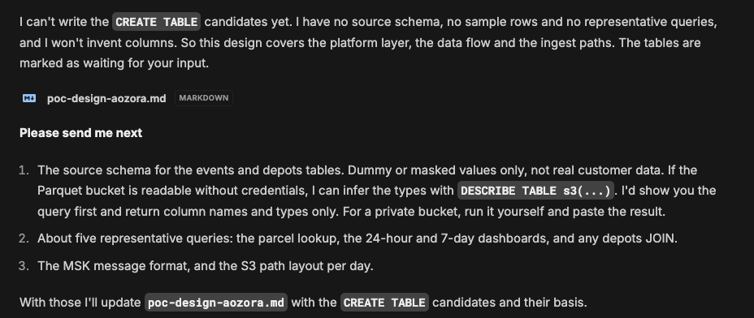

Paste them, and the agent writes `CREATE TABLE` candidates. Each choice (`ORDER BY`, `PARTITION BY`, types) names the rule or page behind it and the query or answer it was decided from:

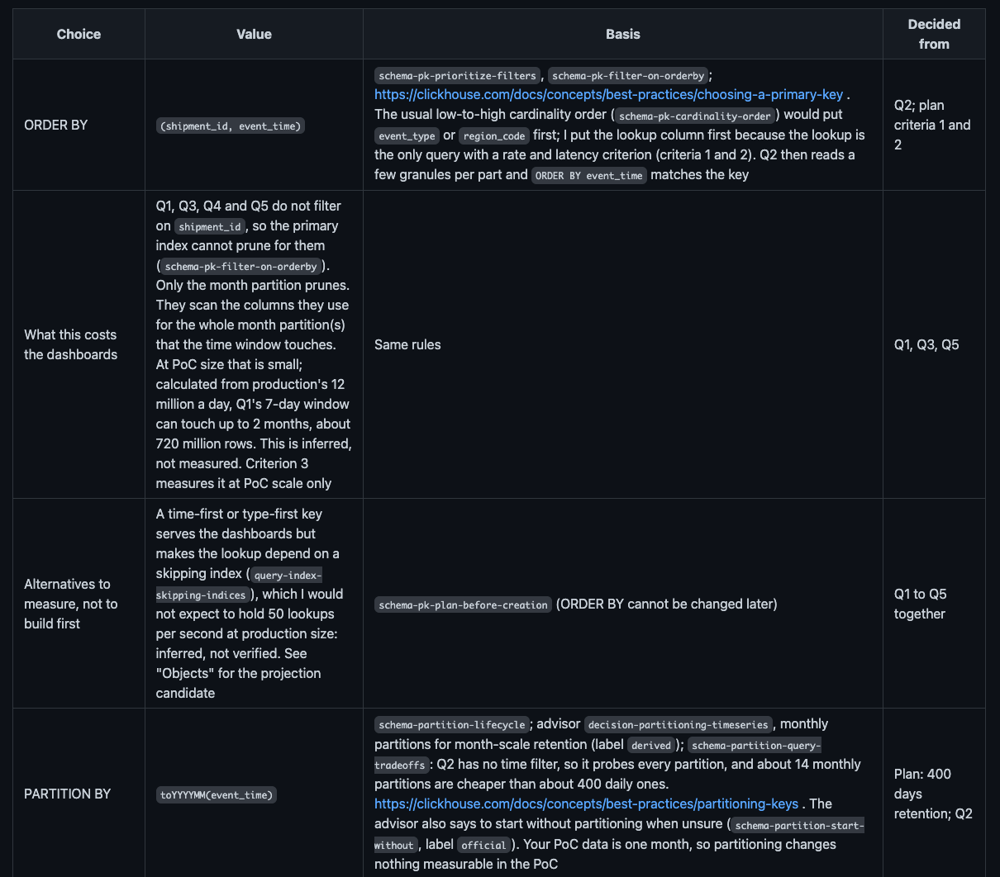

The design is a file, `poc-design-<name>.md`. Attach it next to the plan. For facts on the cloud provider's side, the agent uses the provider's documentation MCP server if you have added one ([setup.md, step 4](setup.md#4-create-the-agent)), sending only general questions; this run had the AWS one and used it for MSK access from another account and data transfer charges. Without one, it gives the provider's documentation URLs.

**Next:** build. That is your work: the agent's connection is read-only. Here the tables were created with `clickhouse-client` and 13 days of dummy data were loaded, with two deliberate mistakes: `shipment_events` was created time-first (`ORDER BY (event_time, shipment_id)`), and 2026-10-09 was left out.

## 3. Check the build against the design (`poc-fit-gap`)

**Ask**, while you build or after, as often as you like:

> I have created the tables in aozora_en. Nothing is loaded yet and nothing is running. Does the build match the design?

**What comes back:** one row per item of the design, with what the design expects, what the service has now, a status (matches, differs, not there yet, not checked) and the query it was read from. For each difference it gives both candidates, change the design or change the build, with a source, and the next steps in order. Here it found the time-first `ORDER BY`. (It also found rows already in the tables, because the test data had been loaded just before; it reported what it read, not what it was told.)

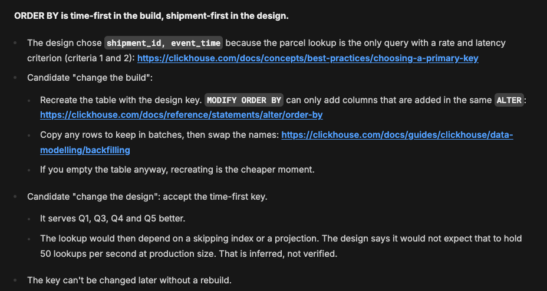

To compare row counts, give it the source's counts:

> … The warehouse has 5,600,000 rows in shipment_events (2026-10-01 to 2026-10-14, 400,000 per day, UTC) and 120 in depots. …

To count rows per day in your table, it first shows the queries with their `EXPLAIN ESTIMATE` and waits for your approval. After approval it found the missing day:

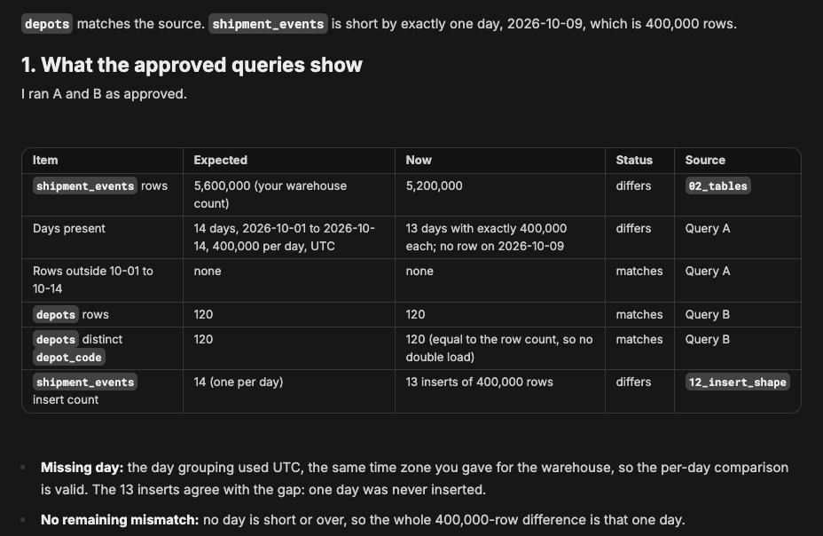

**Next:** fix what you decide to fix (here: load 2026-10-09), and paste the lines it proposes into the plan's `## Results` and `## Log`.

## 4. Review the tables and queries (`poc-schema-query-advisor`)

**Ask** after you have run your representative queries, tagged with `log_comment`:

> I ran the representative queries five times each with the design's log_comment tags. Nothing is running now. Please review the schema and these queries.

**What comes back:** up to five candidates, each with what was observed in system tables, the rule or documentation page behind it, how to verify it, and how it relates to the design. Here: under the time-first key the parcel lookup read about half the table's marks on average, and every lookup returned 0 rows, so the parcel IDs used for the test did not exist.

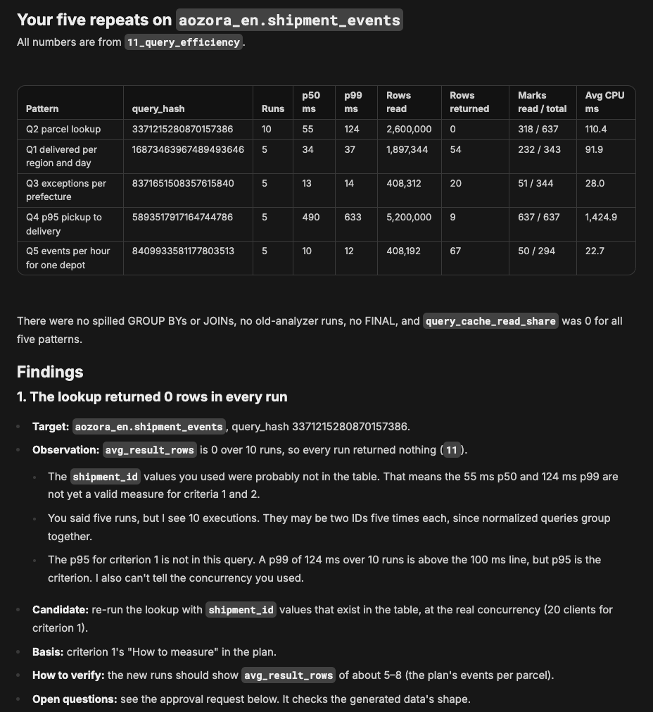

**Next:** the candidates are things to verify, not decisions. Here the table was rebuilt with the design's `ORDER BY`, keeping the old one as `shipment_events_old`.

## 5. Sizing statistics and load tests (`poc-sizing-stats`, `poc-load-test-review`)

**Ask:**

> I've attached the plan and the design. Could you pull together usage statistics for poc-demo that we can use for sizing? …

The agent first asks whether a load test is running and which period to use (here the request already said), then runs the sizing queries and offers each result as a CSV.

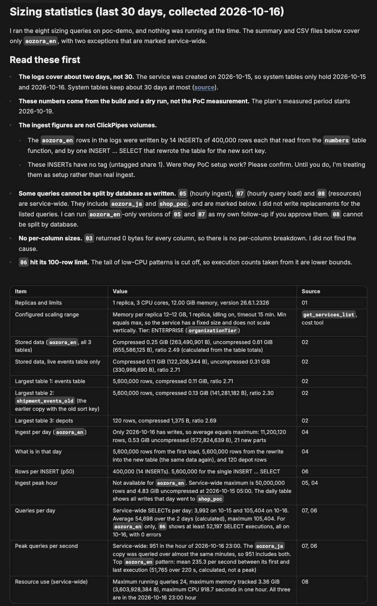

Then run a load test yourself, tag it with `log_comment`, and ask for a review. Here the lookup ran twice at 20 concurrent clients for 60 seconds: on the old time-first table and on the rebuilt one.

> … api_load_1 on the old table from 23:03:31 to 23:04:31 UTC, and api_load_2 on the rebuilt table from 23:06:12 to 23:07:12 UTC … Could you compare the two lookup runs and tell me how to read them against criterion 1?

**What comes back:** p95 per run against the criterion, where the time went (CPU, waiting for CPU, I/O), and whether the comparison was fair (the cache state, what else changed).

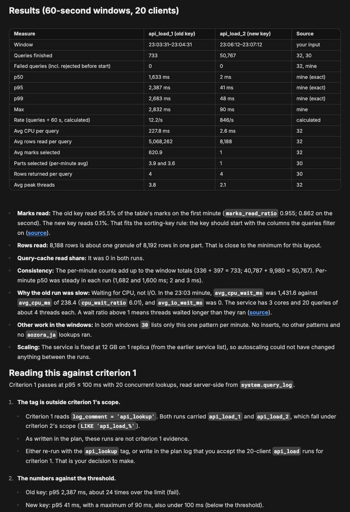

**Next:** whether a run counts depends on the tags in the criterion's scope in the plan. Here criterion 1 reads only `api_lookup`, and these runs carry `api_load_*`, so the agent does not count them. It also points out that each table was measured once and the cache conditions differed. Rerun with the plan's tag and equal conditions, or change the plan.

## 6. Daily note and summary (`poc-daily-progress`, `poc-summary`)

**Ask:**

> Please write today's daily note, with what we should do tomorrow.

**What comes back:** the last 24 hours, where each criterion stands, new advice (only for what changed) and the next actions, plus result lines to paste into the plan's `## Results`.

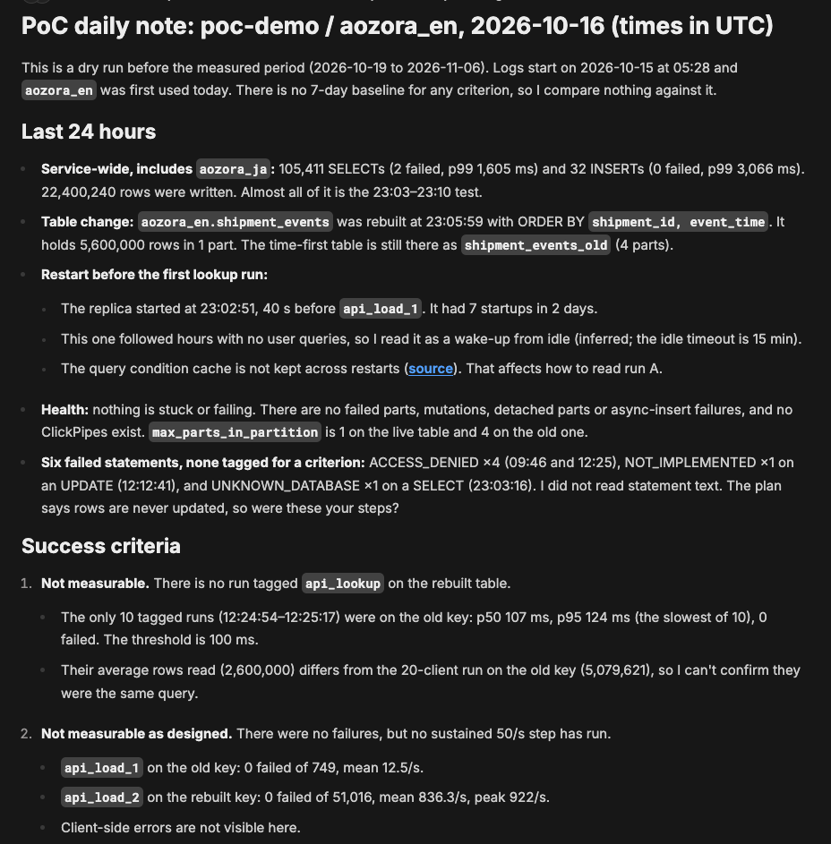

For a meeting, ask for a summary:

> We're taking this to an internal decision meeting. Could you write up a summary of the PoC so far?

The summary is a Markdown document that opens beside the chat:

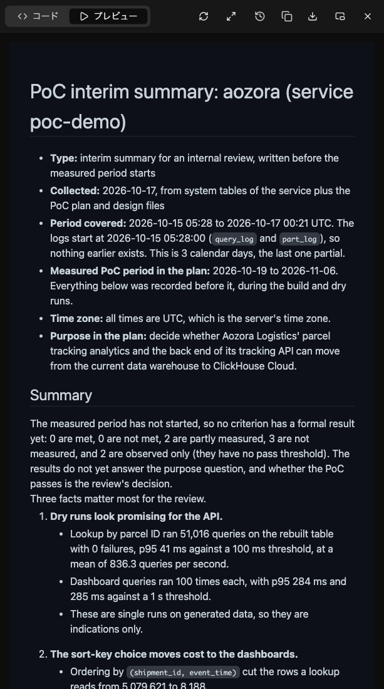

## 7. Cost projection and share report (`poc-cost-projection`, `poc-share-report`)

**Ask:**

> Can you also give us a rough monthly cost for production? Same assumptions as the plan: 12 million events a day, kept for 400 days, the tracking API around the clock and dashboards on weekdays from 9:00 to 18:00 JST.

**What comes back:** a list-price projection with every formula and rate. It is not a quote, and the agent does not choose a size: lines it has no input for (here the replica count and memory for compute) stay out of the total.

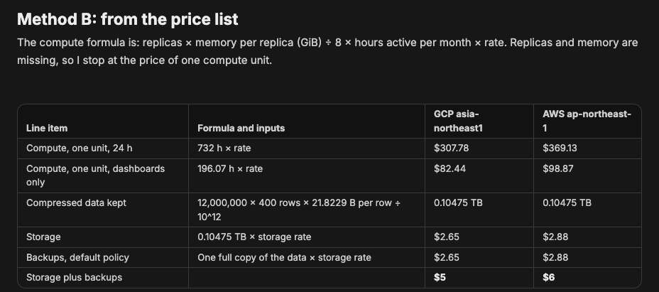

Decision outputs (summary, cost projection, share report) end with a one-line note that the assistant can make mistakes:

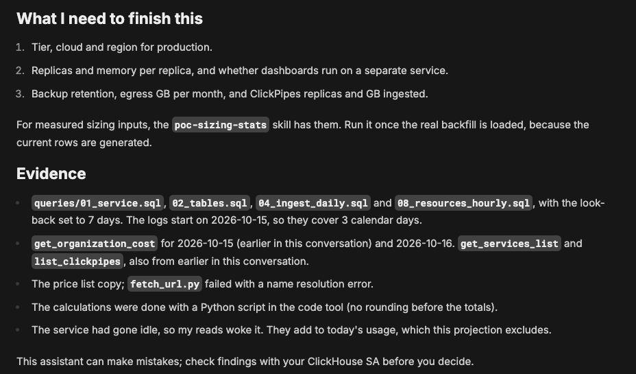

To share with your ClickHouse contact:

> Could you turn what we have so far into a report I can send to our ClickHouse contact?

**What comes back:** a report with findings, aggregate numbers, checks and questions for the SA. Table, column and service names are replaced by labels, and the label mapping stays in the chat only.

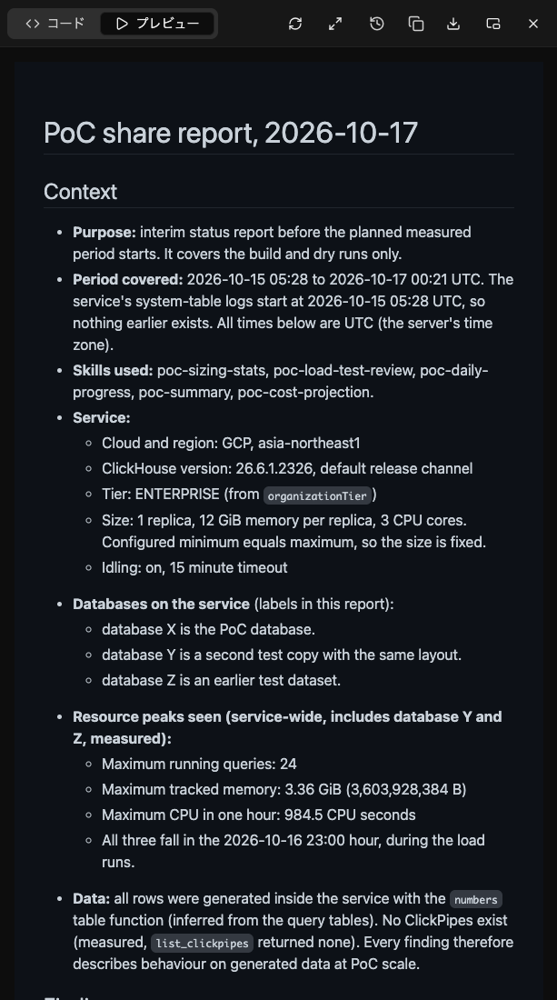

**Next:** read the report before you send it; the agent does not send it.
